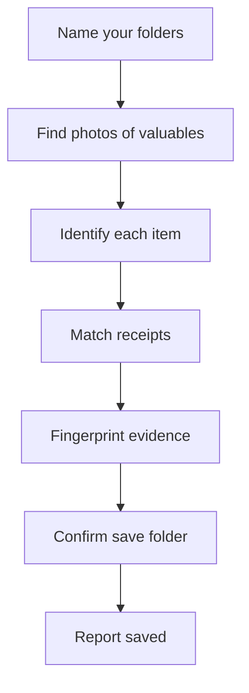

# Proof of Ownership

[](LICENSE)
[](https://ugreenhackathon.devpost.com/)
[](https://ai.ugreen.com/pages/hackathon-starter-kit)

Turn the photos and receipts already sitting on your UGREEN AI NAS into a claim ready home inventory.

After a fire, flood, or burglary, insurers ask you to list everything you lost and prove you owned it. Almost nobody keeps a home inventory, so claims get underpaid. The proof usually exists already, scattered across years of everyday photos that happen to show the TV, the bikes, and the guitar, plus scanned or photographed receipts. Proof of Ownership finds that evidence and turns it into one report you can hand to an insurer.

## Quick start

* Install the skill on your UGREEN AI NAS. See Install below.
* Say: "Make an insurance inventory of my stuff from my photos."
* Answer the questions: which photo folders, which receipt folders, and which mode.
* Confirm the folder when the skill asks where to save the report.

## What you get

* A room by room inventory of your valuables, one row per physical item
* Dated photo evidence for every item, with first seen and last seen dates
* Receipt prices matched to items, copied exactly as printed
* A proof rating for every item: Strong, Moderate, or Weak
* A gaps to fix now list that tells you exactly what proof is still missing
* A SHA-256 fingerprint for every evidence file, so you can later show nothing was altered
* In loss mode, a report scoped to the affected rooms, with days from last seen to the loss date
* After a theft, an optional list of camera events inside the incident window, without ever identifying anyone

The last seen date is the key differentiator. An insurer asks not only "did you own it" but "did you still own it when the loss happened". The skill reports the newest photo of each item for that reason.

## Proof ratings

* **Strong:** at least one photo, plus a matched receipt with a printed price, plus a legible serial number or a printed brand and model
* **Moderate:** a matched receipt, or two or more photos on different dates showing a printed brand and model
* **Weak:** photos only, with no printed brand or model, or a single photo on a single date
* A receipt match flagged low confidence counts as no receipt for this rating.

## How it works



* Step 1: verify the folders you named exist and can be read.
* Step 2: search photos for valuables, label photos, and photographed receipts.
* Step 3: identify each physical item, grouping photos of the same item together.
* Step 4: list receipt documents in your receipt folders.
* Step 5: read receipts and match them to items by type, brand, model, and date.
* Step 6: fingerprint every evidence file with SHA-256.
* Step 7 (loss mode, theft only): list camera events inside the incident window.
* Step 8: compose the report and save it after you confirm the folder.
* Step 9 (optional): gather all evidence photos into one album.

Five registered NAS experts do the work (file, photo, document, knowledge, security monitor). Each step passes only verified results forward. The parent skill never runs a command itself.

## Example report

Example output, using the synthetic test data in `proof-of-ownership/references/test-plan.md`. Names, prices, and serials are invented.

```
Home Inventory Evidence, preparedness mode, run 2026-11-08

Summary: 5 items. Strong 1, Moderate 2, Weak 2. Receipts matched: 3.

Living room
  Television | Samsung QN55Q80B | SN 0A1B2C3D4E | good | first seen 2023-04-02 | last seen 2026-10-18 | 5 photos | Best Buy 2023-03-28 $899.99 | Strong
  Sofa | not visible | no serial | good | first seen 2024-01-15 | last seen 2026-09-30 | 6 photos | no receipt found | Weak

Office
  Laptop | Dell XPS 13 9315 | SN 9Z8Y7X6W5V | good | first seen 2024-06-11 | last seen 2026-10-02 | 3 photos | Dell 2024-06-01 $1,199.00 | Moderate

Garage
  Bicycle | Trek FX 3 | no serial | good | first seen 2025-05-20 | last seen 2026-08-14 | 2 photos | Trek Store 2025-05-10 $749.99 | Moderate
  Guitar | not visible | no serial | good | first seen 2026-02-08 | last seen 2026-02-08 | 1 photo | no receipt found | Weak

Gaps to fix now
  * Guitar: take one close photo of the label and find the receipt.
  * Sofa: take one close photo of the label.
```

## Why it runs on the NAS

Years of family photos and financial documents are too large and too private for a cloud upload. The work runs where the data already lives. The skill only reads by default, never guesses values, and saves nothing without your confirmation.

## Install

* You need a UGREEN AI NAS running UGOS.
* Copy the `proof-of-ownership` folder into the skills directory your AI assistant uses.
* Reload or restart the assistant.
* Check the skill with the official checker:

```text
node uliya-skill-kit/scripts/check-skill.mjs proof-of-ownership
```

The checker is part of the UGREEN Skill Developer Package. See the [Hackathon Starter Kit](https://ai.ugreen.com/pages/hackathon-starter-kit) for the download and setup guide.

## Use it

Say one of these to your assistant:

* "Make an insurance inventory of my stuff from my photos."
* "We were burgled on Tuesday, the office and garage were hit, rebuild a list of what was in those rooms."

The skill asks for:

* Mode: preparedness or loss.
* Photo folders and receipt folders to search.
* Date range and item categories (optional).
* In loss mode: the loss date, the affected rooms, and whether it was a theft.

Two modes:

* **Preparedness mode** (default): build the inventory before anything happens, and show which proof is missing while it can still be fixed.
* **Loss mode:** scope the inventory to the affected rooms, report the last seen date of each item relative to the loss date, and optionally collect camera events for a theft window.

## Project structure

```
Proof-of-Ownership/
  README.md
  LICENSE
  proof-of-ownership/
    SKILL.md
    references/
      disclosures.md
      item-categories.md
      report-format.md
      test-plan.md
```

* `SKILL.md`: the skill itself. Goal, required inputs, the nine step workflow, and completion and failure handling.
* `references/item-categories.md`: item categories, search keywords, label and receipt OCR terms, and the vision prompt.
* `references/report-format.md`: report layout and the proof strength rubric.
* `references/test-plan.md`: core tests, edge cases, and the synthetic test data set.
* `references/disclosures.md`: third party components, AI tools used, and data handling.

## Privacy and safety

* Read only by default. Steps 1 to 7 only read. The only writes are the report file and the optional album, both after you confirm.
* Never guesses. Brand, model, serial number, and price are recorded only when they are visible or printed. Anything else reads "not visible" or "no receipt found".
* Never identifies people in photos or camera footage.
* No direct external calls. Vision and document work uses Uliya platform models.
* Nothing in this package contains credentials, personal data, or API keys.

## Testing

* A synthetic test plan lives in `proof-of-ownership/references/test-plan.md`. It covers a preparedness inventory, loss mode after a burglary, and an empty folder edge case.
* All test data is synthetic. Every test receipt is marked SAMPLE TEST DATA.
* Round 1 does not need a NAS. Finalists test on a real UGREEN AI NAS.

## Hackathon

Built for the UGREEN Hackathon 2026 on AI NAS. Round 1 entry. Prize pool $46,000. Grand prize $20,000. Event page: https://ugreenhackathon.devpost.com/

## Contributing

Issues and pull requests are welcome. Keep the rules in `SKILL.md` intact: no guessing, no invented values, read only until the user confirms a save.

## License

Apache License 2.0. See [LICENSE](LICENSE).
